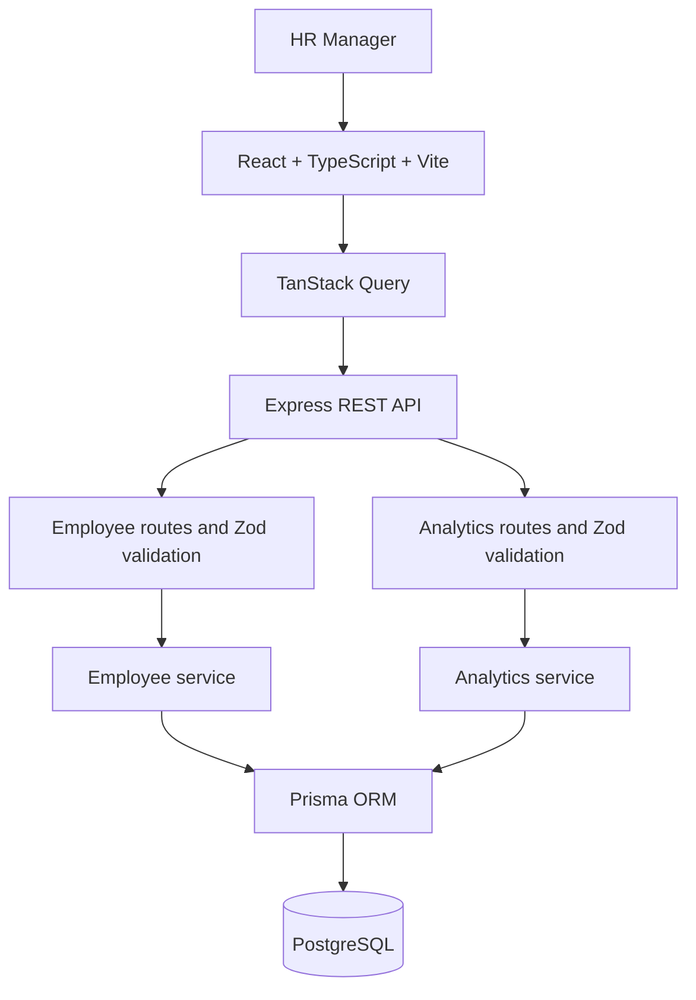
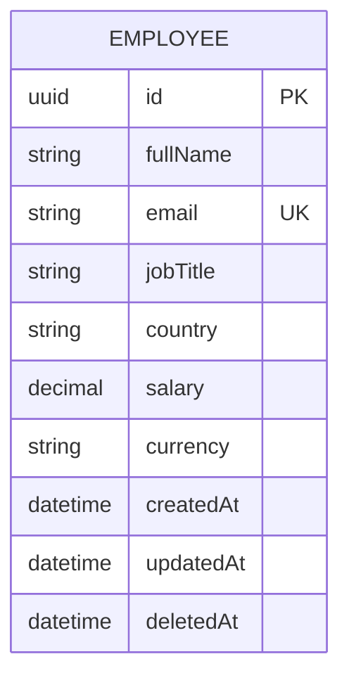

# ACME People — Architecture & Engineering Decisions

## 1. System context

ACME People is a web application for an HR Manager to maintain employee salary records and understand workforce compensation across five supported countries. The system is intentionally limited to employee records and country-scoped compensation analytics.

## 2. High-level architecture

The browser calls the versioned API under `/api/v1`. Route handlers validate incoming parameters and delegate persistence and aggregation to service modules. Both employee operations and analytics use the same PostgreSQL-backed employee model.

## 3. Runtime responsibilities

| Layer | Responsibility |
|---|---|
| React UI | HR workflows, accessible forms, tables, dashboard visualizations |
| TanStack Query | Server-state fetching, caching, invalidation and loading/error states |
| Express | HTTP routing, request parsing, CORS and centralized error handling |
| Zod validators | Validate and normalize employee payloads, filters, pagination and country queries |
| Employee service | Server-side filtering, pagination, CRUD and soft deletion |
| Analytics service | Country-level salary aggregates and job-title grouping |
| Prisma ORM | Typed relational data access |
| PostgreSQL | Durable records, uniqueness, checks and indexes |

## 4. Data model

The current relational model is intentionally small.

- `email` is unique.
- `country`, `currency` and `jobTitle` use the supported domain values.
- The database enforces country/currency consistency and a non-negative salary.
- `deletedAt` is nullable. A null value represents an active employee.
- There are no separate department, payroll, salary-history or approval entities because those concepts are outside the current requirements and data contract.

## 5. Employee request lifecycle

1. The UI submits a create, update, list or delete request.
2. Express routes the request to the employee controller.
3. Zod validates request data before service execution.
4. The employee service applies active-record constraints and server-side filters.
5. Prisma ORM executes the operation against PostgreSQL.
6. The controller returns the API response; TanStack Query refreshes affected client queries after mutations.

Employee listing performs pagination and count aggregation in the database. The browser does not download all 10,000 employees to filter or paginate locally.

## 6. Analytics lifecycle

Analytics are scoped to one country per detailed salary query. The analytics service filters to active employees and asks PostgreSQL to calculate count, minimum, maximum and average salary. A separate grouped query calculates employee count and average salary by job title.

The global workforce view combines active employee counts across supported countries. Local-currency salary amounts are not summed or ranked across countries. No exchange-rate conversion is performed.

## 7. Important engineering decisions

| Decision | Benefit | Trade-off / limitation |
|---|---|---|
| PostgreSQL | Relational integrity and database-side aggregates | Requires a running database for integration tests and local development |
| React + Vite | Focused client application and fast development loop | Client routing and API contracts are maintained in this repository |
| Express | Small, explicit HTTP boundary | Validation and module boundaries must be kept consistent by the team |
| Prisma ORM | Typed access to relational data | Current project uses Prisma ORM 8 release-candidate packages; version changes need migration review |
| TanStack Query | Centralized server-state cache and mutation invalidation | Query keys and invalidation behavior require tests |
| Server-side pagination | Bounded response size for 10,000 records | Count queries add database work |
| Database aggregates | Avoids loading full employee sets into application memory | Query performance must be measured on representative data |
| Soft deletion | Retains records while excluding them from active views | Every active query must consistently filter `deletedAt IS NULL` |
| Country-scoped salary analytics | Avoids misleading cross-currency comparisons | Users cannot view a converted global compensation total |
| Deterministic batched seed | Repeatable synthetic demo dataset without a single huge insert | Seed intentionally aborts when employee rows already exist |

## 8. Performance and scale considerations

The current target is the assessment's 10,000 employee dataset, not an unbounded HRIS workload.

- Employee list and count queries execute on the server.
- Country and country/job-title indexes support common filters and grouping.
- Analytics use database aggregates rather than fetching employees into Node.js.
- Seed inserts are issued in batches of 500.
- Substring search currently uses case-insensitive `ILIKE '%term%'`. A normal B-tree index is not expected to optimize arbitrary leading-wildcard searches. A trigram index is a possible PostgreSQL-specific optimization, but should only be adopted after inspecting query plans and measured latency.

See [performance.md](./performance.md) for the reproducible benchmark procedure. No latency target is claimed until results have been measured in a stated environment.

## 9. Reliability, security and operational boundaries

- Request data is validated at the API boundary.
- Database uniqueness and check constraints protect core data invariants.
- CORS is configured from `CLIENT_URL`.
- The assessment integration test uses a dedicated Neon test branch and a restricted database role. It is separate from the deployed application's runtime database.
- The test branch is intended for synthetic assessment data only. The integration test creates a uniquely named employee and soft-deletes it during cleanup.
- The assessment repository currently includes the test connection configuration to make the integration test runnable by evaluators without provisioning their own PostgreSQL instance. This is a convenience for this assessment, not a production credential-management pattern. The role should be restricted to the test database and rotated or revoked after evaluation.
- Never use the assessment test connection for production workloads, schema migrations, or seeding.
- Authentication and authorization are not implemented because they were explicitly excluded from the assessment scope. This is not a recommendation for a production HR deployment.

## 10. Deliberate non-goals

Payroll execution, payslips, taxes, attendance, leave, recruitment, performance management, salary history, approval workflows, external benchmarking and FX conversion are excluded. Adding these would require new domain models, data sources and business rules not present in the assessment.
